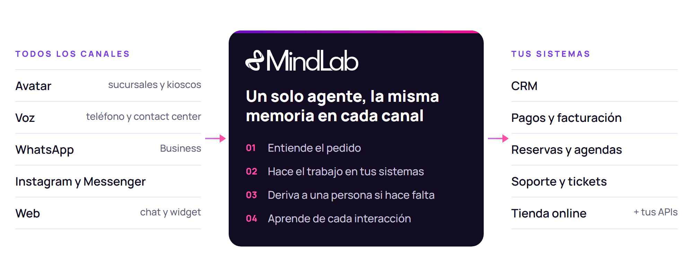
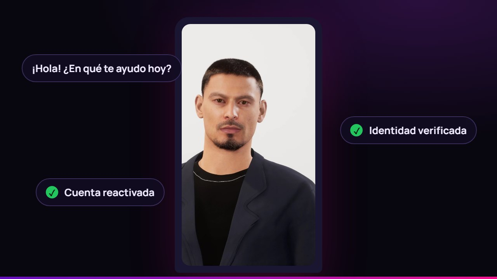
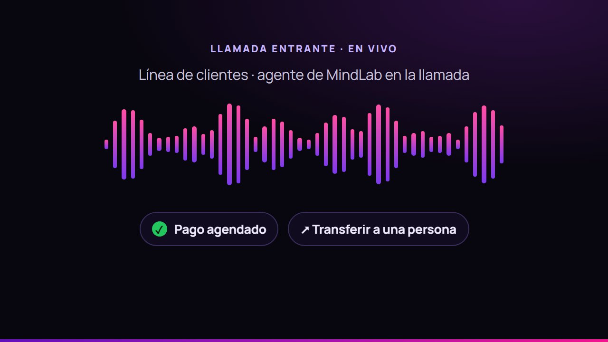
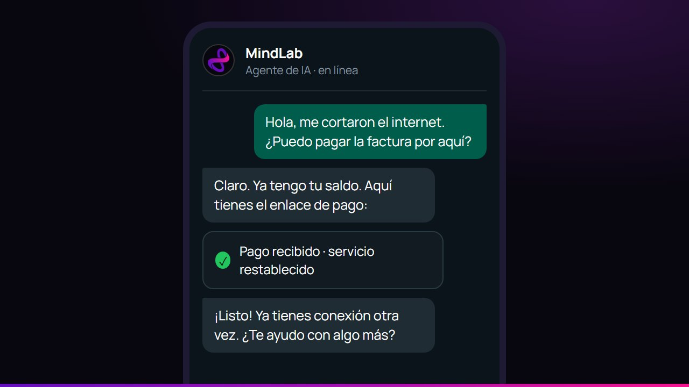
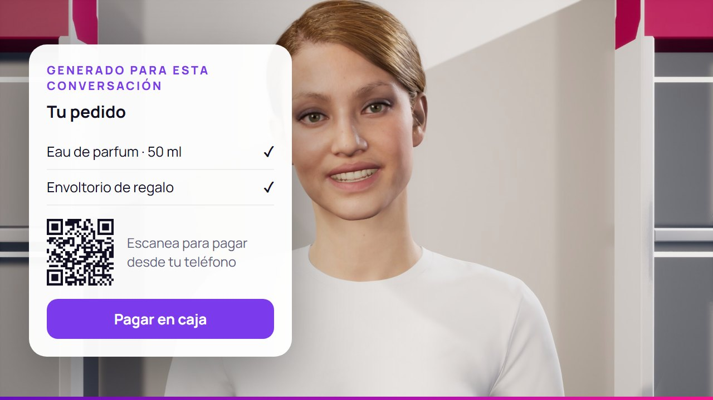
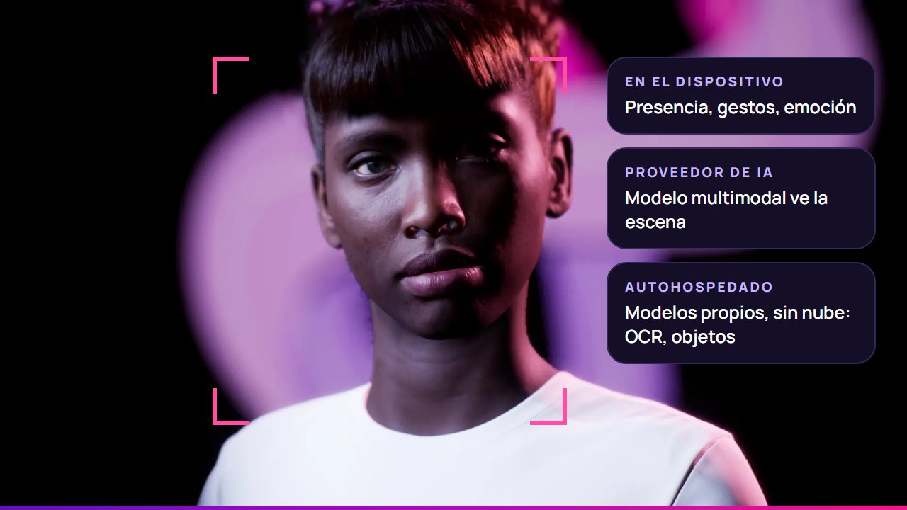
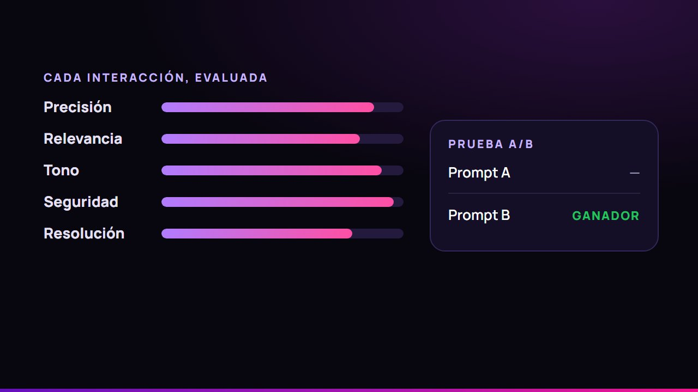
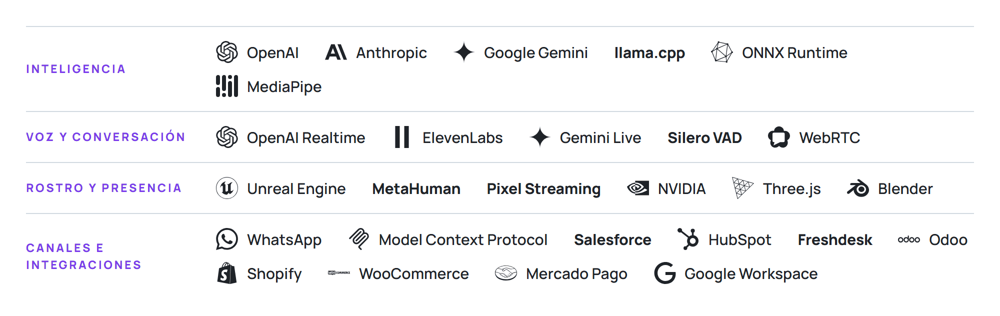
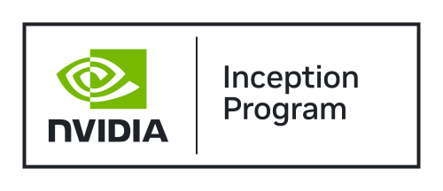

  <a href="https://mind-lab.ai/es?demo=1"><b>Agendar demo</b></a>
  &nbsp;·&nbsp;
  <a href="https://mind-lab.ai/es">mind-lab.ai</a>
  &nbsp;·&nbsp;
  <a href="https://wa.me/5491125610493">Habla con nuestro agente por WhatsApp</a>
  &nbsp;·&nbsp;
  <a href="https://mind-lab.ai/es/blog">Blog</a>
  &nbsp;·&nbsp;
  <a href="https://www.linkedin.com/company/mindlab-ai">LinkedIn</a>
  &nbsp;·&nbsp;
  <a href="https://github.com/mind-lab-ai-org">English</a>

 

MindLab es **el sistema operativo para agentes digitales**. Nuestros agentes se ocupan de la experiencia del cliente de punta a punta: entienden qué necesita cada persona, hacen el trabajo en los sistemas de la empresa y cierran el caso — agendan, venden, cobran, reactivan cuentas, dan soporte. En la web, en WhatsApp, por teléfono y cara a cara en sucursales y kioscos.

 

## Cómo funciona

<picture>
  <source media="(prefers-color-scheme: dark)" srcset="https://raw.githubusercontent.com/mind-lab-ai-org/.github/main/profile/assets/flujo-es-oscuro.png">
  
</picture>

 

## Por qué MindLab

**01 — Ejecuta, no solo responde.**
Los agentes se conectan a tu CRM, pagos, reservas, soporte y comercio electrónico por MCP y APIs, y terminan la tarea en lugar de pasarle un enlace al cliente.

**02 — Un agente en todos los canales, también en la sucursal.**
Chat web, WhatsApp, Instagram, Messenger, voz y un avatar fotorrealista en kioscos y pantallas, todos con el mismo conocimiento y la misma memoria. Llevar la atención con IA a la sucursal física es algo que la mayoría de las plataformas de agentes no hace.

**03 — Hecho para que sigas en control.**
Agentes especializados que se pasan los casos entre sí y a una persona cuando hace falta. Elige el proveedor y el modelo de IA para cada agente, sin quedar atado a nadie. Cada interacción se evalúa para que el agente mejore todo el tiempo.

 

## Qué construimos

<table>
<tr>
<td width="50%" valign="top">

### Avatar en sucursal
Un agente fotorrealista en kioscos y pantallas que recibe al cliente, lo entiende por voz y resuelve el pedido en el momento: pagos, cambios de cuenta, soporte técnico. Verifica la identidad cuando el proceso lo pide y deriva a tu equipo cuando hace falta una persona.

[Avatar en sucursal →](https://mind-lab.ai/es/solutions/branch-avatar)
</td>
<td width="50%" valign="top">

### Contact center de voz
El mismo agente atiende llamadas en Vonage y Telnyx, con tus números. Voces naturales, interrupciones que maneja como una persona y transferencia a tu equipo con todo el contexto.

[Contact center de voz →](https://mind-lab.ai/es/solutions/voice-contact-center)
</td>
</tr>
<tr>
<td width="50%" valign="top">

### Agente de WhatsApp
Tus clientes ya te escriben por WhatsApp. El agente responde ahí y hace las acciones que habilites — pagos, reservas, cambios de cuenta — en los sistemas que ya usas.

[Agente de WhatsApp →](https://mind-lab.ai/es/solutions/whatsapp-agent)
</td>
<td width="50%" valign="top">

### Interfaces generativas
Mientras habla, el agente muestra interfaces armadas para ese momento: el resumen de un pedido, un QR de pago, una comparación de planes, la confirmación de un turno. El cliente ve y confirma; nadie llena un formulario.

</td>
</tr>
<tr>
<td width="50%" valign="top">

### Visión, de tres formas
Percepción en el dispositivo (presencia, gestos, emoción), visión con el modelo multimodal del proveedor de IA, o nuestros propios modelos autohospedados, sin nube, para escenas, objetos y texto. Eliges lo que encaja con tus reglas de privacidad.

</td>
<td width="50%" valign="top">

### Mejora cada semana
Un juez LLM evalúa cada interacción en precisión, relevancia, tono, seguridad y resolución. Las mejoras salen solo después de que una prueba A/B las confirma, y cada conversación queda auditable.

</td>
</tr>
</table>

 

## Conoce a los agentes

<table>
<tr>
<td width="42%" valign="middle">

</td>
<td width="58%" valign="middle">

Cada agente tiene una cara, una voz y un trabajo. Mira a diez de ellos presentarse — recepción, banca, clínica, moda, soporte técnico, hotel, eventos, gastronomía y más — con sonido y la transcripción completa.

Elige uno de nuestros personajes o diseña el tuyo, con tu marca y tu voz.

[Ver a los agentes →](https://mind-lab.ai/es/avatar-agents) 
[Galería de retratos →](https://mind-lab.ai/es/gallery)

</td>
</tr>
</table>

 

## Dónde funciona

| Industria | Qué resuelven los agentes |
|:---|:---|
| **Telecomunicaciones e ISP** | Reactivaciones, cambios de plan, pagos, soporte de primer nivel, avatar en sucursal |
| **Banca y servicios financieros** | Consultas de productos, pagos, alta de clientes, turnos, orientación en sucursal |
| **Seguros** | Cotizaciones, consultas de cobertura, denuncia de siniestros, estado de reclamos |
| **Retail y comercio electrónico** | Asesoramiento, seguimiento de pedidos, venta asistida, posventa |
| **Salud** | Turnos, recordatorios, orientación administrativa |
| **Servicios públicos** | Facturación, pagos, cortes, reconexiones, oficinas de atención |

Nativo en **español e inglés**, para Estados Unidos y América Latina. [Todas las industrias →](https://mind-lab.ai/es/industries)

 

## Construido con

<picture>
  <source media="(prefers-color-scheme: dark)" srcset="https://raw.githubusercontent.com/mind-lab-ai-org/.github/main/profile/assets/muro-es-oscuro.png">
  
</picture>

Independiente del modelo: eliges el proveedor y el modelo para cada agente y los cambias sin volver a desplegar. [Tech stack completo →](https://mind-lab.ai/es/tech-stack)

 

## Confianza desde el diseño

- **Siempre se presenta como IA.** Cada implementación avisa que la persona habla con un agente de IA.
- **Las personas siguen en el circuito.** Los agentes derivan con todo el contexto, y las decisiones financieras, legales, médicas y de identidad mantienen supervisión humana.
- **Tus datos son tuyos.** No vendemos datos personales ni los usamos para entrenar modelos compartidos.
- **Aislado y protegido.** Los agentes, el conocimiento y las conversaciones de cada cliente están separados, con cifrado, control de acceso y monitoreo. Hacemos la revisión de seguridad contigo.

[Centro de confianza →](https://mind-lab.ai/es/trust)

 

<a href="https://www.nvidia.com/en-us/startups/">
  <picture>
    <source media="(prefers-color-scheme: dark)" srcset="https://raw.githubusercontent.com/mind-lab-ai-org/.github/main/profile/assets/nvidia-inception-oscuro.svg">
    
  </picture>
</a>

  

## Trabaja con nosotros

- **[Programa piloto](https://mind-lab.ai/es/pilot)** — empieza con un proceso y clientes reales, medido desde el primer día.
- **[Calculadora de ROI](https://mind-lab.ai/es/roi-calculator)** — estima cuánto ahorra un agente con tus propios volúmenes.
- **[Partners](https://mind-lab.ai/es/partners)** — para telcos e ISP, integradores de sistemas y agencias.
- **[Kit de marca](https://mind-lab.ai/es/brand)** — logos, renders y material de prensa.

 

## El equipo

**Juan Balan** — CEO · **Cesar Cappellini** — COO · **Felipe Traina** — CTO
 Con ingenieros de backend, frontend, DevOps e integraciones en Estados Unidos y América Latina.

 

## Míralo funcionando

La forma más rápida de entender MindLab es ver a un agente resolver uno de tus propios procesos. En la demo revisamos el proceso que quieres automatizar, tus canales y tus sistemas.

  <a href="https://mind-lab.ai/es?demo=1"><b>Agendar demo →</b></a>
  &nbsp;&nbsp;·&nbsp;&nbsp;
  <a href="https://wa.me/5491125610493">O pregúntale a nuestro agente por WhatsApp</a>

 

---

<b>MindLab AI</b> · Newport Beach, California · Estados Unidos y América Latina · <a href="https://mind-lab.ai/es">mind-lab.ai</a> · <a href="https://mind-lab.ai/es/privacy">Privacidad</a> · <a href="https://mind-lab.ai/es/ai-policy">Política de IA</a>
