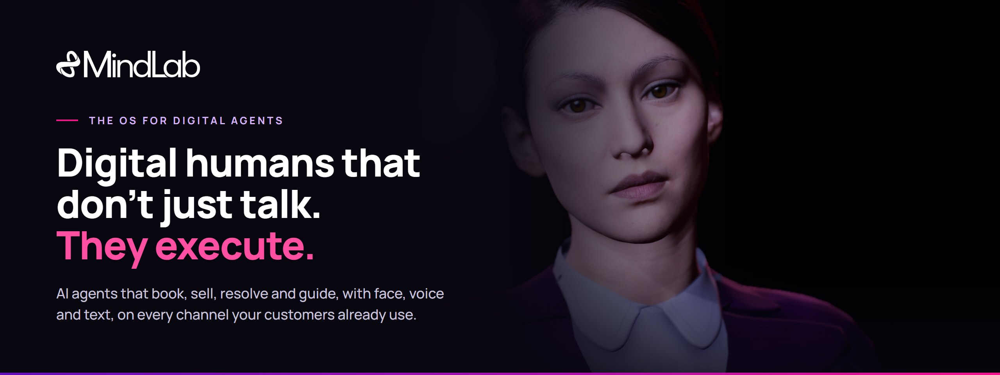
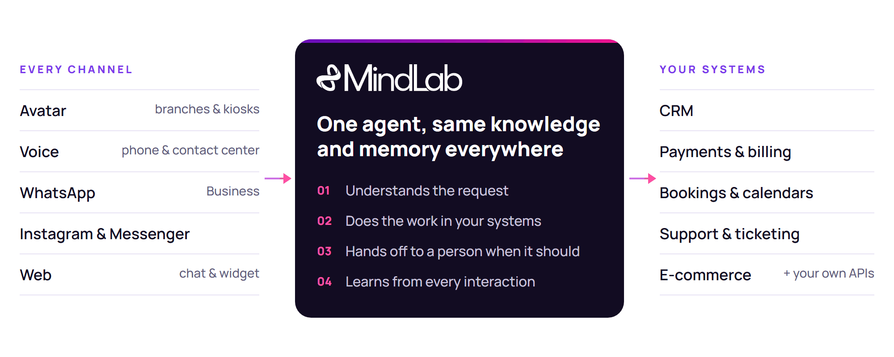

  <a href="https://mind-lab.ai/?demo=1"><b>Book a demo</b></a>
  &nbsp;·&nbsp;
  <a href="https://mind-lab.ai">mind-lab.ai</a>
  &nbsp;·&nbsp;
  <a href="https://wa.me/5491125610493">Talk to our agent on WhatsApp</a>
  &nbsp;·&nbsp;
  <a href="https://www.linkedin.com/company/mindlab-ai">LinkedIn</a>
  &nbsp;·&nbsp;
  <a href="https://github.com/mind-lab-ai-org/.github/blob/main/profile/README.es.md">Español</a>

 

MindLab is **the OS for digital agents**. Our agents take care of customer experience end to end: they understand what people need, do the work in the company's systems and close the loop — booking, selling, collecting payments, reactivating accounts, giving support. On the web, on WhatsApp, on the phone, and face to face in branches and kiosks.

 

## How it works

<picture>
  <source media="(prefers-color-scheme: dark)" srcset="https://raw.githubusercontent.com/mind-lab-ai-org/.github/main/profile/assets/flujo-oscuro.png">
  
</picture>

 

## Why MindLab

**01 — It executes, it doesn't just answer.**
Agents connect to your CRM, payments, bookings, support and e-commerce through MCP and APIs, and finish the task instead of handing the customer a link.

**02 — One agent, every channel, including the branch.**
Web chat, WhatsApp, Instagram, Messenger, voice and a photorealistic avatar on kiosks and screens, all with the same knowledge and memory. Bringing AI service into the physical branch is something most agent platforms don't do.

**03 — Built to stay in your control.**
Specialized agents that hand cases to each other and to a person when it matters. Choose the AI provider and model per agent, with no lock-in. Every interaction is evaluated so the agent keeps getting better.

 

## A face for your front desk

Real-time MetaHuman avatars that greet customers, understand them by voice — interruptions included — and resolve the request on the spot. While they talk, they show interfaces built for the moment: a payment QR, a plan comparison, an appointment confirmation. Choose one of our characters or design your own, with your brand.

 

## Where it works

| Industry | What the agents handle |
|:---|:---|
| **Telecom & ISPs** | Reactivations, plan changes, payments, tier-1 support, in-branch avatar |
| **Banking & financial services** | Product inquiries, payments, onboarding, appointments, in-branch guidance |
| **Insurance** | Quotes, coverage questions, first notice of loss, claim status |
| **Retail & e-commerce** | Product advice, order tracking, assisted sales, post-sale |
| **Healthcare** | Appointment booking, reminders, administrative guidance |
| **Utilities & public services** | Billing, payments, outages, reconnections, service offices |

Native in **English and Spanish**, serving the United States and Latin America.

 

## See it working

The quickest way to understand MindLab is to watch an agent solve one of your own processes. In the demo we look at the process you want to automate, your channels and your systems.

  <a href="https://mind-lab.ai/?demo=1"><b>Book a demo →</b></a>

 

---

<b>MindLab AI</b> · Newport Beach, California · United States and Latin America · <a href="https://mind-lab.ai">mind-lab.ai</a> · <a href="https://mind-lab.ai/privacy">Privacy</a> · <a href="https://mind-lab.ai/ai-policy">AI policy</a>
