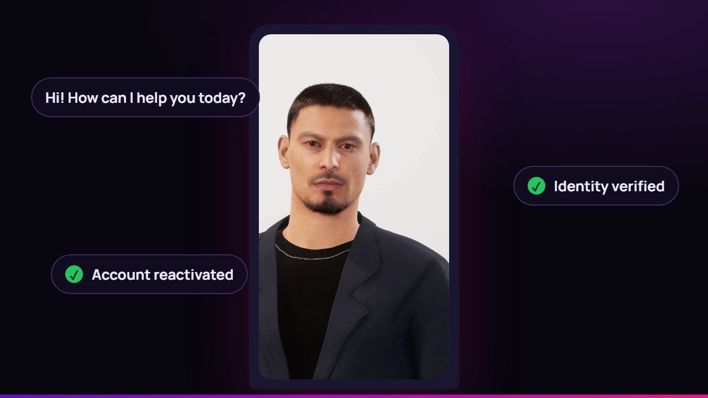
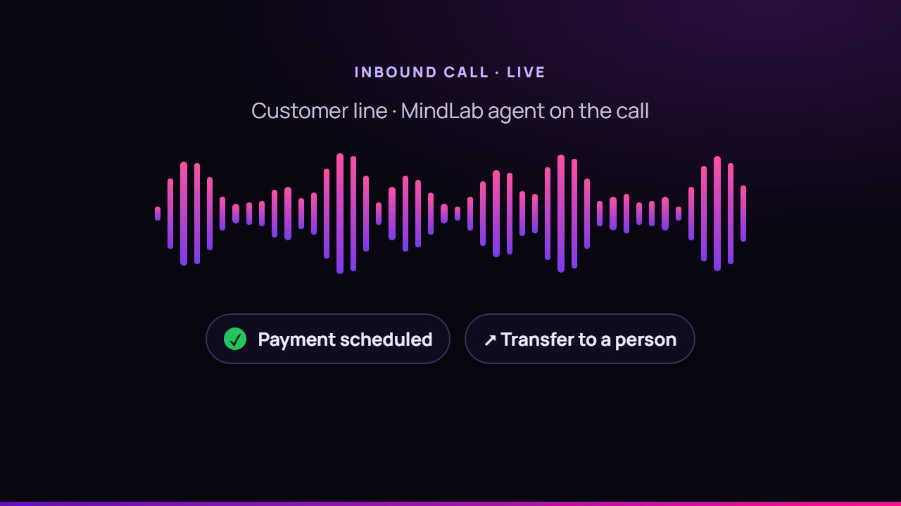
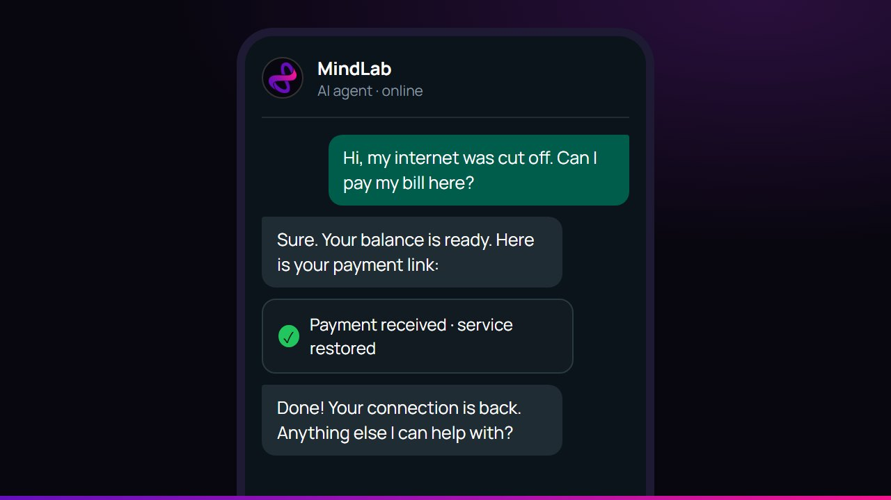
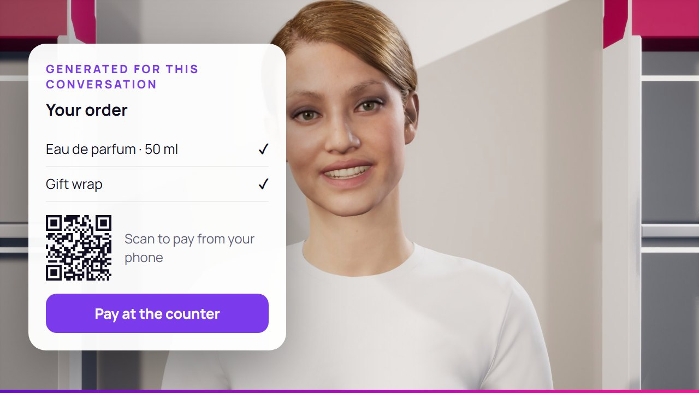
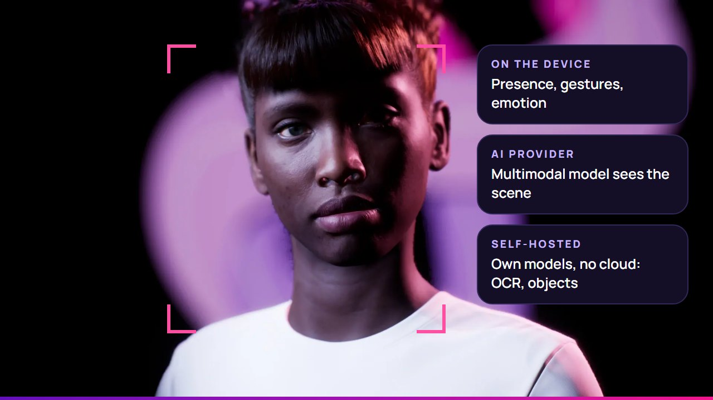
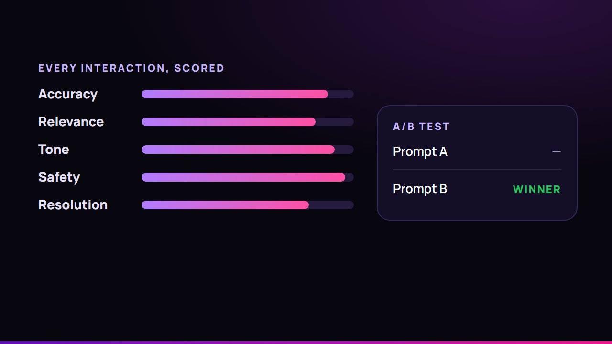
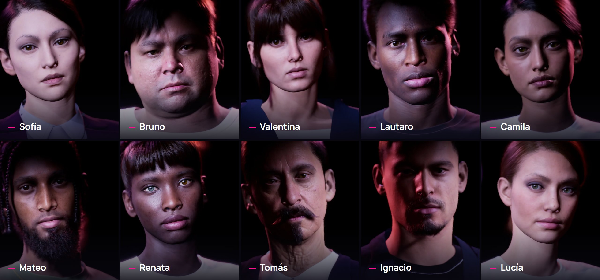
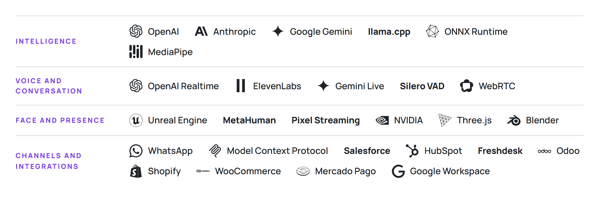

  <a href="https://mind-lab.ai/?demo=1"><b>Book a demo</b></a>
  &nbsp;·&nbsp;
  <a href="https://mind-lab.ai">mind-lab.ai</a>
  &nbsp;·&nbsp;
  <a href="https://wa.me/5491125610493">Talk to our agent on WhatsApp</a>
  &nbsp;·&nbsp;
  <a href="https://mind-lab.ai/blog">Blog</a>
  &nbsp;·&nbsp;
  <a href="https://www.linkedin.com/company/mindlab-ai">LinkedIn</a>
  &nbsp;·&nbsp;
  <a href="https://github.com/mind-lab-ai-org/.github/blob/main/profile/README.es.md">Español</a>

 

MindLab is **the OS for digital agents**. Our agents take care of customer experience end to end: they understand what people need, do the work in the company's systems and close the loop — booking, selling, collecting payments, reactivating accounts, giving support. On the web, on WhatsApp, on the phone, and face to face in branches and kiosks.

 

## How it works

<picture>
  <source media="(prefers-color-scheme: dark)" srcset="https://raw.githubusercontent.com/mind-lab-ai-org/.github/main/profile/assets/flujo-oscuro.png">
  
</picture>

 

## Why MindLab

**01 — It executes, it doesn't just answer.**
Agents connect to your CRM, payments, bookings, support and e-commerce through MCP and APIs, and finish the task instead of handing the customer a link.

**02 — One agent, every channel, including the branch.**
Web chat, WhatsApp, Instagram, Messenger, voice and a photorealistic avatar on kiosks and screens, all with the same knowledge and memory. Bringing AI service into the physical branch is something most agent platforms don't do.

**03 — Built to stay in your control.**
Specialized agents that hand cases to each other and to a person when it matters. Choose the AI provider and model per agent, with no lock-in. Every interaction is evaluated so the agent keeps getting better.

 

## What we build

<table>
<tr>
<td width="50%" valign="top">

### Branch avatar
A photorealistic agent on kiosks and screens that greets customers, understands them by voice and resolves the request on the spot: payments, account changes, technical support. It verifies identity when the process needs it and hands off to your staff when a person is needed.

[Branch avatar →](https://mind-lab.ai/solutions/branch-avatar)
</td>
<td width="50%" valign="top">

### Voice contact center
The same agent takes phone calls on Vonage and Telnyx, with your numbers. Natural voices, interruptions handled like a person would, and transfer to your team with the full context.

[Voice contact center →](https://mind-lab.ai/solutions/voice-contact-center)
</td>
</tr>
<tr>
<td width="50%" valign="top">

### WhatsApp agent
Customers already write to you on WhatsApp. The agent answers there and carries out the actions you enable — payments, bookings, account changes — in the systems you already run.

[WhatsApp agent →](https://mind-lab.ai/solutions/whatsapp-agent)
</td>
<td width="50%" valign="top">

### Generative interfaces
While it talks, the agent shows interfaces built for that moment: an order summary, a payment QR, a plan comparison, an appointment confirmation. The customer sees and confirms; nobody fills in a form.

</td>
</tr>
<tr>
<td width="50%" valign="top">

### Vision, three ways
Perception on the device (presence, gestures, emotion), vision through the AI provider's multimodal model, or our own self-hosted models with no cloud for scenes, objects and text. You pick what fits your privacy rules.

</td>
<td width="50%" valign="top">

### Gets better every week
An LLM judge scores every interaction on accuracy, relevance, tone, safety and resolution. Improvements ship only after an A/B test proves them, and every conversation stays auditable.

</td>
</tr>
</table>

 

## Meet the agents

<table>
<tr>
<td width="42%" valign="middle">

</td>
<td width="58%" valign="middle">

Each agent has a face, a voice and a job. Watch ten of them introduce themselves — front desk, banking, clinic, retail, tech support, hotel, events, restaurant and more — with sound and full transcripts.

Choose one of our characters or design your own, with your brand and your voice.

[Watch the agents →](https://mind-lab.ai/avatar-agents) 
[Portrait gallery →](https://mind-lab.ai/gallery)

</td>
</tr>
</table>

 

## Where it works

| Industry | What the agents handle |
|:---|:---|
| **Telecom & ISPs** | Reactivations, plan changes, payments, tier-1 support, in-branch avatar |
| **Banking & financial services** | Product inquiries, payments, onboarding, appointments, in-branch guidance |
| **Insurance** | Quotes, coverage questions, first notice of loss, claim status |
| **Retail & e-commerce** | Product advice, order tracking, assisted sales, post-sale |
| **Healthcare** | Appointment booking, reminders, administrative guidance |
| **Utilities & public services** | Billing, payments, outages, reconnections, service offices |

Native in **English and Spanish**, serving the United States and Latin America. [All industries →](https://mind-lab.ai/industries)

 

## Built with

<picture>
  <source media="(prefers-color-scheme: dark)" srcset="https://raw.githubusercontent.com/mind-lab-ai-org/.github/main/profile/assets/muro-en-oscuro.png">
  
</picture>

Model-agnostic by design: choose the provider and model per agent and switch without redeploying. [Full tech stack →](https://mind-lab.ai/tech-stack)

 

## Trust, by design

- **Always disclosed as AI.** Every deployment tells people they are talking to an AI agent.
- **People stay in the loop.** Agents hand off with full context, and financial, legal, medical and identity decisions keep human oversight.
- **Your data is yours.** We don't sell personal data or use it to train shared models.
- **Isolated and protected.** Each customer's agents, knowledge and conversations are kept separate, with encryption, access control and monitoring. We go through your security review with you.

[Trust center →](https://mind-lab.ai/trust)

 

<a href="https://www.nvidia.com/en-us/startups/">
  <picture>
    <source media="(prefers-color-scheme: dark)" srcset="https://raw.githubusercontent.com/mind-lab-ai-org/.github/main/profile/assets/nvidia-inception-oscuro.svg">
    
  </picture>
</a>

  

## Work with us

- **[Pilot program](https://mind-lab.ai/pilot)** — start with one process and real customers, measured from day one.
- **[ROI calculator](https://mind-lab.ai/roi-calculator)** — estimate what an agent saves on your own volumes.
- **[Partners](https://mind-lab.ai/partners)** — for telcos and ISPs, system integrators and agencies.
- **[Brand kit](https://mind-lab.ai/brand)** — logos, renders and press material.

 

## The team

Backend, frontend, DevOps and integration engineers across the United States and Latin America.

 

## See it working

The quickest way to understand MindLab is to watch an agent solve one of your own processes. In the demo we look at the process you want to automate, your channels and your systems.

  <a href="https://mind-lab.ai/?demo=1"><b>Book a demo →</b></a>
  &nbsp;&nbsp;·&nbsp;&nbsp;
  <a href="https://wa.me/5491125610493">Or ask our agent on WhatsApp</a>

 

---

<b>MindLab AI</b> · Newport Beach, California · United States and Latin America · <a href="https://mind-lab.ai">mind-lab.ai</a> · <a href="https://mind-lab.ai/privacy">Privacy</a> · <a href="https://mind-lab.ai/ai-policy">AI policy</a>
